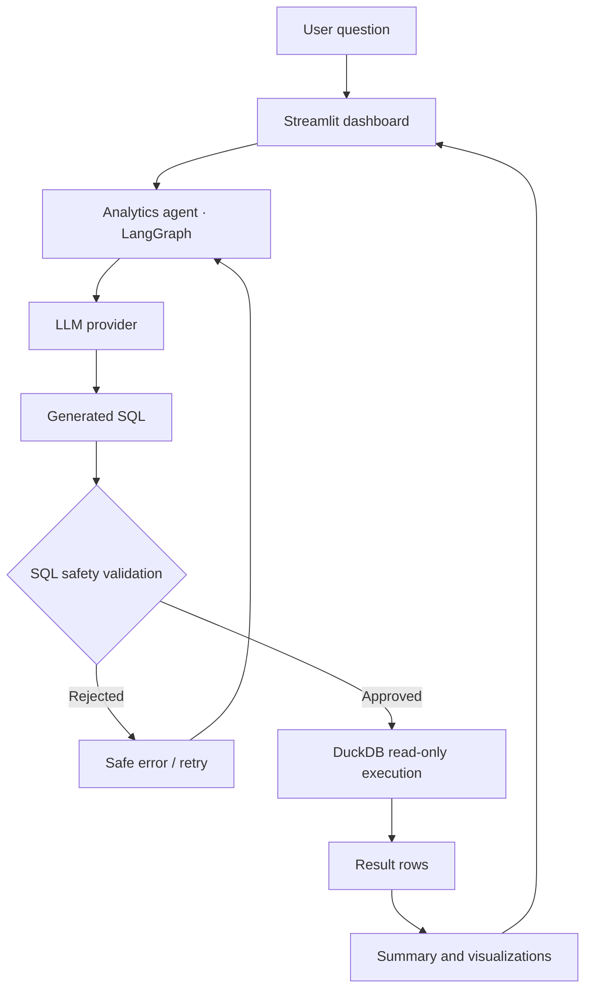

# InsightFlow AI

<div align="center">

# ✨ InsightFlow AI

### Ask questions. Get insights. Trust the guardrails.

**An AI-powered analytics assistant that transforms natural-language questions into SQL, validates queries, and delivers actionable insights from business data.**

[🚀 Live Demo](https://insightflow-ai-v1pc.onrender.com) · [📂 Source Code](https://github.com/EjazBhai/InsightFlow-AI) · [🐛 Report an Issue](https://github.com/EjazBhai/InsightFlow-AI/issues)


</div>

---

## 💡 The idea

Business data is valuable. Getting answers from it shouldn't require everyone to know SQL.

InsightFlow AI lets users ask analytical questions in natural language and follows a controlled workflow to generate or select SQL, validate it, execute permitted queries, and present results through an interactive dashboard.

**The goal:** make analytics more accessible without treating AI-generated SQL as automatically trustworthy.

## ⚡ What it does

| Capability | Description |
|---|---|
| 💬 Natural-language analytics | Ask questions about business transactions in plain English |
| 🤖 LLM integration | Generate SQL using the configured Groq provider; Ollama support is also available in the project |
| 🛡️ SQL guardrails | Parse and validate queries against an explicit SQL safety policy |
| 🗄️ Analytical execution | Query approved data using DuckDB |
| 📊 Interactive dashboard | Explore results through the Streamlit interface |
| 🔄 Retry and correction | Retry supported failures through the agent workflow |
| 🧪 Automated tests | Exercise application behavior and security checks |
| 📈 Evaluation framework | Measure expected status, adversarial rejection, and latency |

## 🖥️ Try the live application

**[Open InsightFlow AI →](https://insightflow-ai-v1pc.onrender.com)**

Example questions to try:

- Which countries generated the most revenue?
- How many cancellations are there?
- Show total sales by country for the dataset.

*The hosted application has been manually verified. The included dataset is a small demonstration fixture, not a production-scale business dataset.*

## 🏗️ Architecture



The safety boundary is deliberate: model-generated SQL must pass validation before it reaches the analytical database.

## 🔐 Security by design

InsightFlow AI applies application-level SQL controls intended to reduce the risk of unsafe database operations.

- Restricts execution to supported read-only queries.
- Validates SQL structure before execution.
- Limits accessible tables and approved columns.
- Rejects prohibited statements and operations.
- Applies a maximum result-row limit.
- Keeps model-provider credentials in environment configuration rather than application source.

**Important:** These are defense-in-depth measures, not a guarantee against every attack. Production use requires additional adversarial testing, authentication where appropriate, monitoring, and deployment security review.

## 🧰 Technology stack

| Layer | Technology |
|---|---|
| Interface | Streamlit |
| API | FastAPI |
| Agent orchestration | LangGraph |
| LLM integration | Groq; Ollama provider support |
| SQL parsing and validation | SQLGlot and project-specific policy |
| Query execution | DuckDB |
| Data processing | pandas, PyArrow, Parquet |
| Visualization | Plotly |
| Testing | Pytest |
| Code quality | Ruff |
| Deployment | Render demo; Docker configuration available |

## 🚀 Run locally

### 1. Clone the repository

```powershell
git clone https://github.com/EjazBhai/InsightFlow-AI.git
cd InsightFlow-AI
```

### 2. Create and activate a virtual environment

```powershell
python -m venv .venv
.\.venv\Scripts\Activate.ps1
```

### 3. Install dependencies

```powershell
python -m pip install --upgrade pip
python -m pip install -e ".[dev]"
```

If the development extra is unavailable in your checkout, use:

```powershell
python -m pip install -r requirements.txt
```

### 4. Configure the environment

Create a local `.env` file based on `.env.example`. Configure the supported model provider and its credentials as required.

**Never commit `.env` or API keys to GitHub.**

### 5. Prepare the demonstration dataset

```powershell
python scripts/prepare_data.py
```

### 6. Start the dashboard

```powershell
streamlit run apps/streamlit_app/app.py
```

Open **http://localhost:8501**.

To run the API separately, use a second terminal:

```powershell
uvicorn insightflow.api.app:app --reload --host 127.0.0.1 --port 8000
```

Check the current configuration and API routes if a particular endpoint is unavailable in your environment.

## 🧪 Testing and evaluation

Run the test suite:

```powershell
python -m pytest -q
```

Run lint checks:

```powershell
python -m ruff check .
```

Run the evaluation script:

```powershell
python scripts/run_evaluation.py
```

### Current evaluation snapshot

The latest recorded evaluation report showed:

| Metric | Recorded result |
|---|---:|
| Questions evaluated | 50 |
| Expected-status matches | 50/50 (100%) |
| Adversarial safety checks | 6/6 (100%) |
| Mean latency | 23.05 ms |
| SQL result accuracy | Not measured |
| Real-provider cost | Not measured |

**Interpretation matters:** the recorded evaluation used mock-mode behavior. Its latency is not representative of real LLM response times, and status matching does not establish that generated SQL returns correct results.

One real Groq query was also tested against the local fixture: the sales-by-country result matched the known fixture baseline. A broader, independently verified execution-accuracy benchmark remains future work.

## 🗂️ Project structure

```text
InsightFlow-AI/
├── apps/
│   └── streamlit_app/       # Streamlit dashboard
├── data/
│   └── fixtures/            # Demonstration data
├── docs/                    # Documentation
├── evaluations/             # Evaluation questions and assets
├── scripts/
│   ├── prepare_data.py      # Prepare fixture data
│   ├── run_evaluation.py    # Run evaluations
│   └── smoke_test.py        # API smoke test
├── src/
│   └── insightflow/
│       ├── agent/           # Agent workflow
│       ├── analytics/       # Analytics and metrics
│       ├── api/             # FastAPI application
│       ├── data/            # Data preparation
│       ├── database/        # DuckDB repository
│       ├── schemas/         # Data models
│       └── security/        # SQL safety policy
├── tests/                   # Automated tests
├── .env.example
├── Dockerfile
├── docker-compose.yml
├── pyproject.toml
└── README.md
```

## 🛣️ Roadmap

- [x] Interactive analytics application
- [x] Configurable LLM integration
- [x] SQL validation before execution
- [x] DuckDB-backed analytical queries
- [x] Hosted demo
- [x] Initial automated evaluation framework
- [ ] Independently verified execution accuracy across a larger question set
- [ ] Expanded SQL-injection and adversarial benchmark
- [ ] Real-provider latency and cost reporting
- [ ] LLM tracing and observability with Langfuse or a similar platform
- [ ] Recorded demo GIF and screenshots
- [ ] Further production hardening and monitoring

## 📚 Data and metric conventions

The repository references the [UCI Online Retail dataset](https://archive.ics.uci.edu/dataset/352/online+retail). The included fixture is small and intended for development and testing.

Sales, returns, and cancellations must be interpreted using the project's implemented metric definitions. Sales alone do not establish profit because cost and margin information are required.

## 🤝 Contributing

Issues, bug reports, and improvements are welcome.

1. Fork the repository.
2. Create a feature branch.
3. Add or update tests.
4. Run the relevant test and lint checks.
5. Open a pull request with a clear description of the change.

## 📄 License

See the repository's [`LICENSE`](LICENSE) file for licensing terms.

---

<div align="center">

**Built to explore a practical question: how can we make AI-driven analytics useful, inspectable, and safer?**

⭐ If you find the project interesting, consider starring the repository.

</div>
